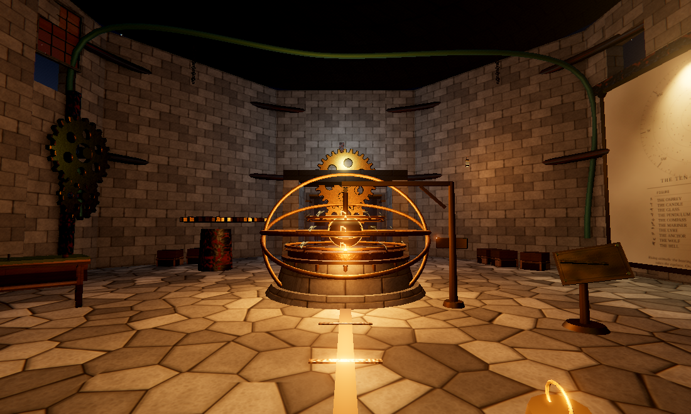
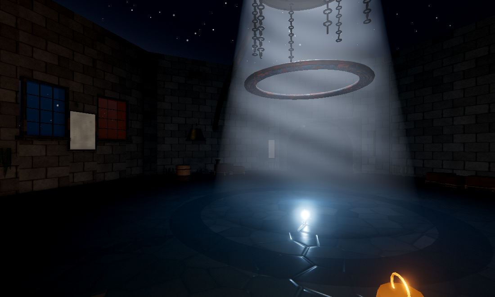
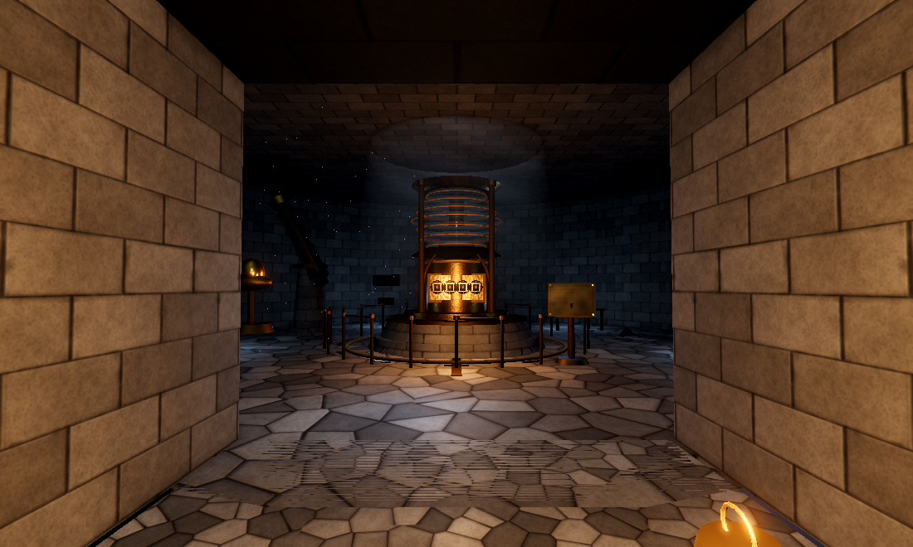
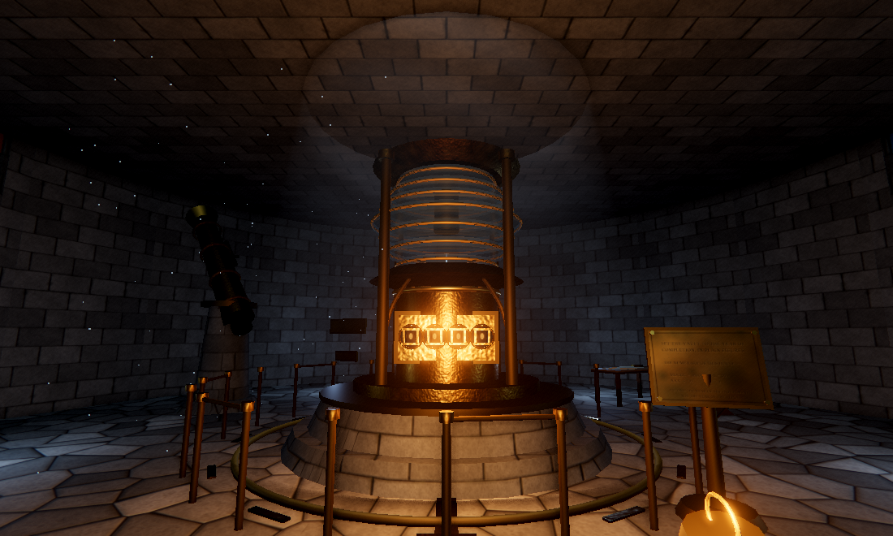

<div align="center">

# Misty Bunny

**A first-person exploration puzzle game in the spirit of *Myst*.**

No combat. No inventory. One continuous tower, and three locks.

</div>



The boatman left you in the flooded antechamber of a lighthouse-observatory on the
edge of a sound, and rowed away without a word. Somewhere above you is a meridian
instrument that was sealed in the last decade of the nineteenth century, and never
opened since.

There is no monster and nothing to fight. There is a tower, a great deal of writing,
and three combinations. Everything you need is written down somewhere in the level —
if you can find it, and if you can read it.

That second half is the whole game.

---

## Contents

- [What it is](#what-it-is)
- [Reading things](#reading-things)
- [Screenshots](#screenshots)
- [Running it](#running-it)
- [Controls](#controls)
- [How it is made](#how-it-is-made)
- [Things that turned out to matter](#things-that-turned-out-to-matter)
- [Tools](#tools)
- [Project layout](#project-layout)
- [Spoilers](#spoilers)

---

## What it is

One continuous space with three locks, each opening onto the next: a flooded
antechamber below, a tall machine hall in the middle, an observatory on top.

The design rule the whole level is built on is that **no single clue gives you a
complete answer**. Every combination is a join across two or three separate pieces
of writing, scattered between rooms and floors. Some of the writing is not even
intact.

Nothing is signposted. Nothing glows or says "this is important". You go looking,
you find nine pages of writing, you copy them into a journal, and then you work out
what the tower is asking you.

It is short. It is meant to be finished in one sitting.

---

## Reading things

The game is *about* reading, which turns out to be the hardest thing to get right
in a 3D game: a sign on a wall is a fine way to **find** a clue and a poor way to
**read** one. At arm's length a tide table is four pixel rows of mush, and half the
pages worth reading are behind a kelp frond or a fall of rubble.

So examining anything written lifts it off the wall into a full-screen view at the
resolution it was drawn at, which you can drag and magnify until a single character
is larger than your hand.

It is the same canvas that is on the prop in the world, so the page you study and
the page you found can never drift apart. Nothing in the level is too far gone to
read.

> Note if you are reading the source: the repository contains the answers, because
> the game has to know them. They live in `src/clues.js` and `src/puzzles/`. That is
> normal for this kind of project and there is no way around it — the code has to be
> able to tell whether you were right.

---

## Screenshots

| | |
|---|---|
|  |  |
| The antechamber. Moonlight through the oculus, a hand lantern, and standing water. | The meridian passage, opening into the vault room. |
|  | |
| The observatory on the top floor. The vault is the last thing standing between you and the ending. | |

*(All captured in-engine, from the tools below — no external renderer, no mockups.)*

---

## Running it

Requires Node 18+ and a WebGL2 browser. Desktop, mouse and keyboard.

```bash
git clone https://github.com/Bynzski/misty-bunny.git
cd misty-bunny
npm install
npm run dev          # http://127.0.0.1:5173
```

Production build:

```bash
npm run build
npm run preview      # http://127.0.0.1:4173
```

`?fx=0` disables the whole post-processing chain, which is useful on software
rasterisers and when you want to see what the scene looks like before grading.

---

## Controls

| | |
|---|---|
| `W` `A` `S` `D` / arrows | walk |
| mouse | look |
| `Shift` | hurry |
| `E` | examine — and on anything written, lift the page off the wall |
| `F` | light or shutter the hand lantern |
| `J` | open the survey journal |
| `H` | a nudge about what to do next |
| `M` | mute |
| `Esc` | release the cursor |

Inside the reading view: drag or arrow keys to move, scroll or `+`/`-` to magnify,
`T` for a plain transcript, `0` to fit the page, `E` or `Esc` to put it back.

---

## How it is made

Built on [three.js](https://threejs.org). There are no model files, no audio files
and no image assets beyond the baked material maps — the level, the machinery, the
star field, the water, the light shafts and the entire soundtrack are all built
when the page loads.

**Materials** are the exception, and deliberately so. The stone, timber, brass and
iron are baked offline into seamless PBR sets by
[`tools/blender/materials.py`](tools/blender/materials.py), which runs inside
Blender and uses its numpy to build tileable height fields and derive albedo, normal
maps and packed AO/roughness/metalness from them.

```bash
npm run bake     # regenerates all six sets in about twelve seconds
```

Each material writes three PNGs. Packing the three scalars into one image is the
glTF ORM convention and is why a material costs three files instead of six. Albedo is
written at full resolution because the fine grain lives there; normal and ORM go out
at half, because a normal map describes shape and its finest useful detail is far
coarser than the grain beside it. The whole library is about 11 MB.

**Everything text-driven is still drawn at runtime** on a 2D canvas: the nine clue
pages, the engraved glyphs, the star chart, the wheel bands, the water normals, and
every sound in the game. That is not a limitation so much as a guarantee — a clue
page and its journal entry are literally the same pixels.

**Rendering** runs three.js through a post chain: ground-truth ambient occlusion for
contact shadows in every mortar joint, a restrained bloom, then tone mapping, and
only then the grade — contrast, a little film grain, and lens dispersion that shows
up at the corners. The order matters more than it sounds.

---

## Things that turned out to matter

Written down because each of these is easy to get wrong and hard to spot by eye.

**An ambient term bright enough to "see by" is the enemy.** It lifts the shadowed
side of a block to the same value as the lit side, and after that no amount of
normal mapping brings the relief back. This level runs on a very low ambient, one
real key light per room, and occlusion to seat everything in its corners.

**Grade after tone mapping, never before.** A contrast curve pivoted on mid grey,
film grain and lens dispersion are all display-referred. Run them on the linear
buffer instead and they subtract a constant from every channel and clip every
shadow to pure black.

**Occlusion passes have to be able to see back faces.** Both masonry vaults here are
built as back faces. The occlusion pass renders its depth and normal buffers by
overriding the scene material, and that override defaults to single-sided — so
anything built that way is simply absent from the buffer, and gets painted solid
black.

**UVs should be world-scaled, everywhere.** The primitives three.js ships with span
0..1 across a face no matter how big that face is, so a crate and a door knob end up
showing the same texture at wildly different scales. The builders bake a box
projection instead, and architecture does the same through an explicit scale, so
texture density is a property of a surface rather than of a material.

**Walkable regions have to overlap, not merely meet.** The player is a circle of
radius 0.32 m. Two regions that touch along a line leave a seam wider than the
player and stop them dead in it.

**Things that break silently deserve tests.** `wallRing` discards any opening wider
than its wall segment — and the doorway to the final room was specified wider than
the segment it had to fit in, so it was never built and the game could only be
finished by teleporting. The suite reached that room by teleporting, so it never
noticed. Similarly, the movement code had the forward vector negated, and the only
tests that exercised it asked *whether* the player had climbed a stair, never
*which way*.

---

## Tools

The game is verified in headless Chrome rather than by eye.

```bash
npm run smoke          # plays the whole level and asserts it works
npm run smoke -- --shots   # ...and writes screenshots to shots/
npm run tour           # photographs 24 vantage points around the level
npm run reader         # photographs the reading view
npm run scans          # renders every clue page to shots/scans/ for proofing
```

`smoke.mjs` is the interesting one. It asserts that all nine clues can be reached
and read; that the reading view opens every page, magnifies well past what the wall
shows, and hands the cursor back; that the foundation stone is unreadable without
the lantern; that **W walks the way the camera faces**; that deep water blocks the
trench and the walls hold; that **the meridian passage can be walked to the dome**;
and then it solves all three puzzles in order through the real UI, clicking the
same buttons a player clicks, and waits for the ending to arrive. It also fails on
any uncaught error or THREE warning.

It drives a real GPU through Vulkan. Without one, Chrome silently falls back to a
software rasteriser that runs this level at under 2 fps and turns every timed wait
into what looks like a hang.

The tools need `puppeteer-core` and a local Chrome. It is a dev dependency only —
the game does not depend on it.

---

## Project layout

```
index.html              the shell, and all of the UI overlays
src/
  main.js               entry point
  game.js               wiring and the frame loop
  clues.js              every clue, the star list, and the answer keys
  style.css             title, HUD, journal, reading view, panels, ending

  core/
    engine.js           renderer, camera, sky, the light rig, and the post chain
    input.js            keyboard + pointer lock
    player.js           first-person movement, collision, wading, head bob
    walkspace.js        the collision model: convex regions with floor functions
    interaction.js      what the crosshair is on
    reader.js           the reading view
    audio.js            the whole soundtrack, synthesised in WebAudio
    ui.js               toasts, prompts, journal, combination panels

  art/
    builders.js         the geometry vocabulary: walls, stairs, gears, props
    pbr.js              loads the baked maps and builds materials from them
    materials.js        the shared palette
    textures.js         every surface that is still drawn at runtime
    maps/               the baked PBR maps (generated, not hand-made)

  world/
    level.js            the plan of the level, and the masonry
    arch.js             wall rings with real openings, shells, domes, ribs
    clueProp.js         turning a clue into a thing you can walk up to
    antechamber.js      Act I — the clues, and the dark corner
    gallery.js          Act II — the chart, the bench, the machine
    dome.js             Act III — the lens plate, the telescope, the vault room

  puzzles/
    wheels.js           the brass odometer wheels
    sluice.js           Act I mechanism
    orrery.js           Act II mechanism + the meridian gate
    lens.js             Act III mechanism + the ending

tools/
  blender/materials.py  bakes the PBR maps (Blender's Python + numpy)
  smoke.mjs             plays the whole level and asserts it works
  tour.mjs              photographs vantage points around the level
  reader-shots.mjs      photographs the reading view
  export-scans.mjs      renders every clue page for proofing
  diag.mjs              one-off: render a vantage with parts of the scene disabled
```

Collision is 2D: the level is a union of convex polygons each with a floor-height
function, and the player is a circle that slides along polygon edges and cannot
climb more than 62 cm in one step. That makes stairs, ramps and the flooded trench
ordinary data rather than special cases.

Puzzles are 3D mechanisms whose state lives in 3D, but whose *input* is a small
brass panel — because odometer wheels are far more satisfying to click than to aim
at. Setting a figure on the panel turns the wheel in the world.

---

## Spoilers

**If you have not finished the game, stop reading here.**

<details>
<summary><b>There is a full solutions file. It gives away every answer.</b></summary>

It is kept in [`SOLUTIONS.md`](SOLUTIONS.md) so the deduction chain can be read and
checked after the fact. It is a single click away and it will spoil the entire game
if you open it early.

</details>

If you are stuck and would rather not be spoiled, press <kbd>H</kbd> in game for a
progressive nudge, or open the journal (`J`) — everything you have examined is
copied in there, legible and permanent, which matters because you are going to have
to carry facts between rooms.

---

## Licence

[MIT](LICENSE). Do what you like with it.

If you fork it and change the puzzles, please keep the rule that no single clue
gives a complete answer. It is the only thing holding the design together.